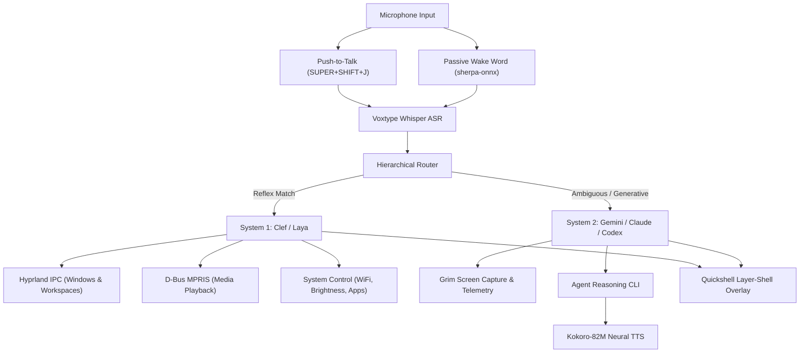

# Omarchy Eva Voice Automation Suite

[](https://opensource.org/licenses/MIT)
[](https://www.python.org/downloads/)
[](https://hyprland.org)

**Omarchy Eva** is a real-time, voice-driven desktop automation suite and reflex engine designed for Omarchy Linux and the Hyprland Wayland compositor.

Eva bridges sub-millisecond local reflex dispatch (System 1) with deliberative multimodal reasoning agents (System 2), giving you complete hands-free voice control over your desktop environment.

---

## Key Features

* **Sub-150ms Reflex Dispatch (System 1):** Direct Unix socket IPC to the Hyprland compositor (`$HYPRLAND_INSTANCE_SIGNATURE`) and D-Bus MPRIS media players for instant window movement, workspace navigation, and volume control.
* **Pluggable Local Decision Engines:**
  * **Clef-Flash (Default):** Ultra-fast, zero-dependency pattern-based decision routing and token extraction with zero warm-up time.
  * **Laya:** Non-autoregressive ModernBERT ONNX decision classifier for typed intent classification.
* **Continuous Passive Wake Word & Follow-Up Mode:** Real-time wake-word detection (*"Eva"*, *"Hey Eva"*) powered by `sherpa-onnx` with trailing open-mic follow-up windows for conversational task chaining.
* **Voxtype ASR Integration:** Native streaming push-to-talk integration with Omarchy's local Whisper ONNX service (`voxtype`).
* **Deliberative Reasoning Bridge (System 2):** Seamlessly escalates complex, creative, or ambiguous requests to Omarchy's agent CLIs (`gemini`, `claude`, `codex`) with live desktop telemetry and screen captures.
* **Natural Context & Pronoun Memory:** Multi-turn antecedent tracking (`"move spotify to workspace 3"` &rarr; `"now close it"` &rarr; `"what did you just say?"`).
* **Two-Tier Visual Grounding:** Sub-35ms framebuffer capture via `grim` paired with local Tesseract OCR bounding boxes and multimodal spatial grounding.
* **Acoustic Earcons & Neural Speech (Kokoro-82M):** Ultra-fast local neural TTS piped to PipeWire (`pw-play`) with subtle 48kHz sound effects.
* **Omarchy Shell Plugin:** Quickshell QML widget (`BarWidget.qml`, `Service.qml`, `HudOverlay.qml`) featuring an animated Arc Reactor indicator and top bar status icon.
* **Proactive Awareness Sentinel:** Background monitor alerting on CPU pressure, memory starvation, low disk space, and network status changes.

---

## Architecture Overview



---

## Prerequisites

* **Operating System:** Omarchy Linux (or Arch Linux with Hyprland Wayland compositor).
* **Audio Stack:** PipeWire with WirePlumber (`pw-play`, `wpctl`).
* **ASR:** [`voxtype`](https://github.com/) Whisper service.
* **Wayland Tools:** `grim` (screenshots), `wl-clipboard` (`wl-copy`, `wl-paste`), `ydotool` or `wtype` (virtual input).
* **Media & Hardware:** `playerctl` (MPRIS), `brightnessctl`, `bluetoothctl`, `nmcli`.
* **Python:** Python 3.10 or newer.

---

## Installation & Setup

### 1. Clone the Repository

```bash
git clone https://github.com/<your-username>/omarchy-eva.git
cd omarchy-eva
```

### 2. Create Virtual Environment & Install Dependencies

```bash
python3 -m venv .venv
source .venv/bin/activate
pip install --upgrade pip
pip install -e .
```

To install optional neural decision, audio, and wake-word components:
```bash
# Install all optional components (Kokoro TTS, ONNX Runtime, sherpa-onnx)
pip install -e ".[all]"
```

### 3. Register Omarchy Shell Widget

Link the repository into your Omarchy plugins directory:

```bash
mkdir -p ~/.config/omarchy/plugins
ln -s "$(pwd)" ~/.config/omarchy/plugins/eddie.eva
```

Reload the Omarchy top bar or shell:
```bash
omarchy-shell reload
```

### 4. Configure Hyprland Push-to-Talk Keybinding

Add the push-to-talk keybinding to your Hyprland configuration (e.g. `~/.config/hypr/bindings.conf` or `bindings.lua`):

```ini
# Press and hold to speak, release to execute
bind = SUPER SHIFT, J, exec, omarchy-eva record-start
bindr = SUPER SHIFT, J, exec, omarchy-eva record-stop
```

---

## Usage

### Starting the Daemon

```bash
# Start the Eva core daemon in the foreground
omarchy-eva-daemon

# Or check daemon status via CLI
omarchy-eva status
```

### CLI Command Examples

```bash
# Direct reflex commands
omarchy-eva exec "switch to workspace 3"
omarchy-eva exec "open spotify"
omarchy-eva exec "now close it"
omarchy-eva exec "pause music"
omarchy-eva exec "set volume to 70 percent"
omarchy-eva exec "mute microphone"
omarchy-eva exec "set brightness to 50 percent"

# Information & Awareness
omarchy-eva exec "who are you"
omarchy-eva exec "what can you do"
omarchy-eva exec "how much disk space do I have left"
omarchy-eva exec "what is using the most CPU"

# Conversational repeat
omarchy-eva exec "what did you say"

# Inspect decision routing
omarchy-eva route "play some daft punk"

# Manage configuration
omarchy-eva config show
omarchy-eva config set verbosity minimal    # minimal | verbose | silent
omarchy-eva config set voice bf_emma        # British female
omarchy-eva config set earcon_volume 0.25   # Subtle earcon chimes
```

---

## Configuration

Eva stores its persistent configuration at `~/.config/eva/config.json`. A reference template is provided in [`config.example.json`](config.example.json).

| Key | Default | Description |
| :--- | :--- | :--- |
| `name` | `"Eva"` | Assistant name and persona |
| `voice` | `"bf_emma"` | Default neural voice (`bf_emma`, `bm_george`, `af_bella`, etc.) |
| `voice_speed` | `1.0` | TTS speech playback speed multiplier |
| `verbosity` | `"minimal"` | Spoken feedback level: `minimal` (silent on visual actions, speak queries/errors), `verbose`, `silent` |
| `sound_effects` | `true` | Enable/disable acoustic earcon chimes |
| `earcon_volume` | `0.25` | Subtle earcon volume (0.0 to 1.0) |
| `hud_enabled` | `true` | Show floating visual HUD overlay during listening and execution |
| `default_agent` | `"gemini"` | Deliberative System 2 agent CLI (`gemini`, `claude`, `codex`) |
| `wake_word_enabled`| `true` | Enable passive continuous wake word detection (*"Eva"*) |
| `follow_up_mode` | `true` | Enable open-mic follow-up listening after commands |
| `follow_up_timeout_sec` | `8.0` | Seconds to wait for follow-up speech before returning to idle |
| `max_follow_up_turns` | `4` | Maximum consecutive follow-up conversational turns |
| `decision_engine`| `"clef-flash"` | Active decision model: `clef-flash`, `clef`, or `laya` |
| `decision_local_only` | `true` | Enforce strictly offline decision routing |

---

## Security & Agent Escalation Notice

When Eva encounters complex, ambiguous, or generative queries, it escalates to the configured System 2 agent CLI (`gemini` or `claude`).
* By default, System 2 executes queries via `gemini ... --yolo` or `claude ... --allow-dangerously-skip-permissions` to allow autonomous execution without interactive terminal approval prompts.
* If you prefer interactive approval or wish to modify the agent parameters, adjust [`core/system2_agent.py`](core/system2_agent.py) or set `EVA_AGENT` in your environment.

---

## Running Unit Tests

```bash
python3 -m unittest discover -s tests -p 'test_*.py'
```

---

## Contributing

Contributions are welcome! Please see [CONTRIBUTING.md](CONTRIBUTING.md) for guidelines on code style, testing, and pull requests.

---

## License

This project is licensed under the [MIT License](LICENSE).
